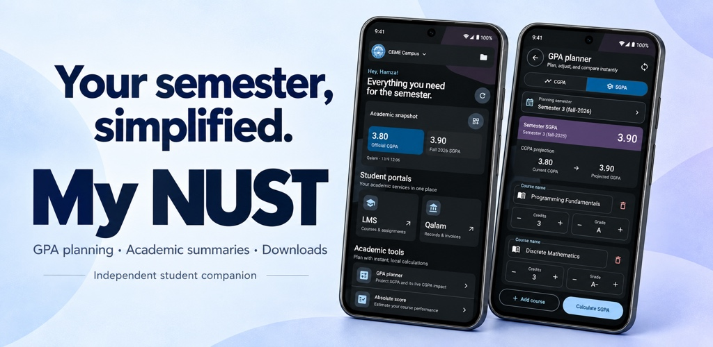
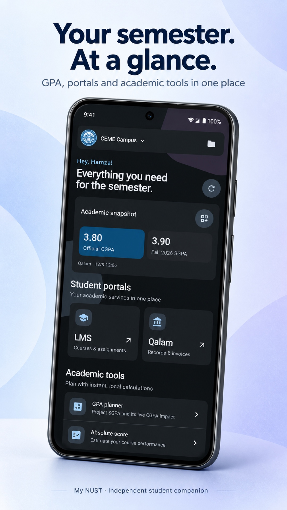
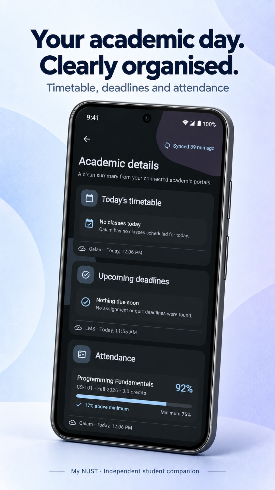
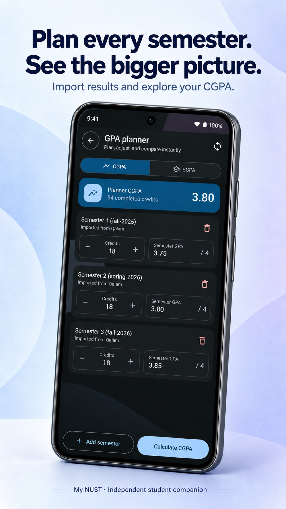
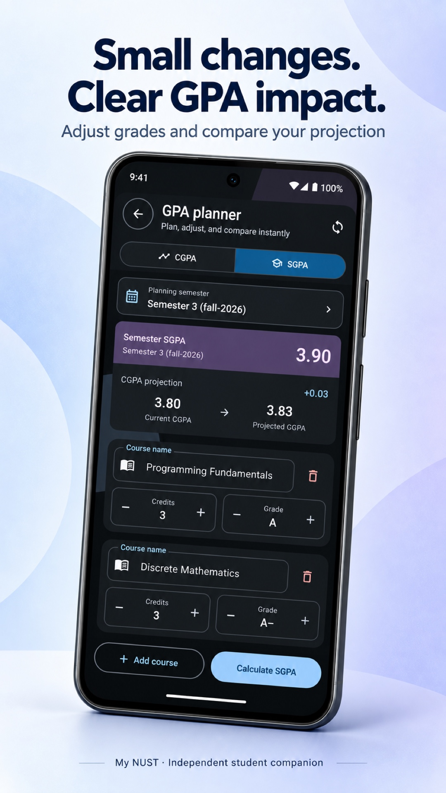
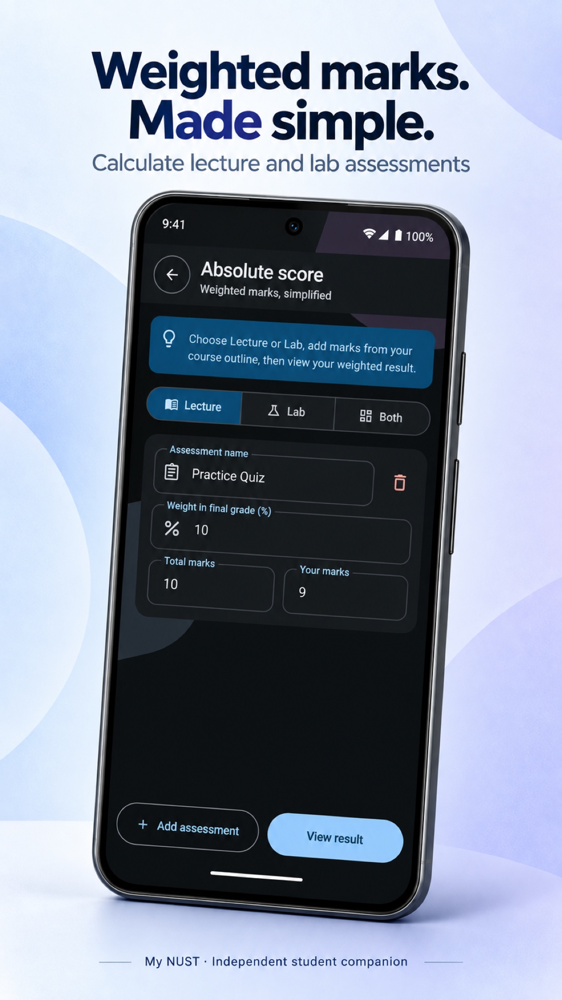
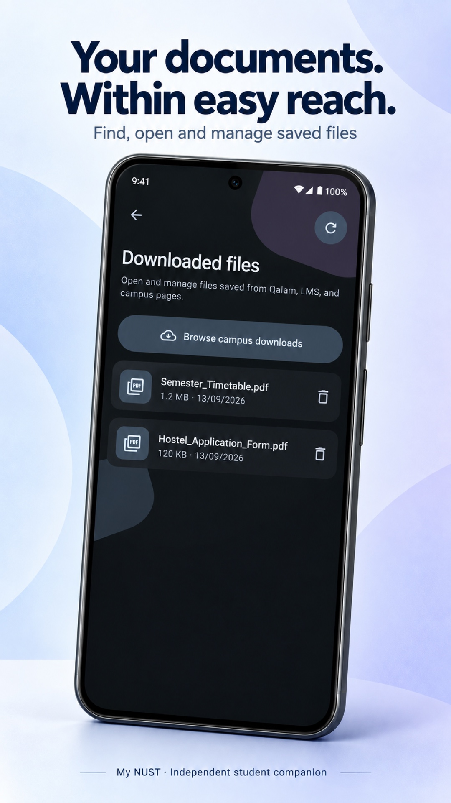

# My NUST — Legacy Open-Source Edition

> **Repository status:** This repository preserves the legacy open-source edition of My NUST. Active product development continues in a separate private repository. This public edition is retained for source reference and existing issue history; new platform features are developed privately.
>
> The source baseline is [`legacy-open-source-baseline-2026-11-06`](https://github.com/Hmmza-tariq/MY-NUST/tree/legacy-open-source-baseline-2026-11-06) (`a132d61`, app `3.0.1+38`). Its published AGPLv3 licence remains available in [LICENSE](LICENSE). See [repository status](docs/REPOSITORY_STATUS.md).

An independent student app for Qalam, LMS, GPA planning and campus updates.
Built with Flutter. Powered by Hexagone.



[Get it on Google Play](https://play.google.com/store/apps/details?id=com.hexagone.mynust) · [Website](https://mynust.web.app/) · [Report an issue](https://github.com/Hmmza-tariq/MY-NUST/issues)

The app is open source. It is not affiliated with, authorized by, or endorsed by
the National University of Sciences & Technology. NUST names, marks and portal
content belong to their respective owners. An iOS release is not currently
available; the earlier App Store branding/authorization issue remains unresolved.

## What it does

- **Academic snapshot:** current CGPA and the latest available semester GPA on
  Home after syncing Qalam.
- **Academic details:** available timetable, LMS deadlines, attendance summaries
  and invoices, with source labels, sync times and links to the official portals.
- **Portal connection:** optional saved credentials for Qalam/LMS autofill and
  automatic academic sync when the app opens. Cached summaries work offline.
- **GPA planner:** import previous Qalam terms and courses, edit grades and
  credits, and compare SGPA with the projected CGPA impact.
- **Absolute calculator:** work out weighted lecture and lab assessment scores.
- **Campus updates:** browse news, notices and document pages for your campus.
- **Downloads:** find, open and manage files saved through supported app pages.
- **Light and dark themes:** updated cards, planning controls and native splash
  screens with theme-aware Hexagone branding.

Portal data depends on what each campus makes available. Sync is not a live feed.
GPA projections and weighted scores are estimates; repeated courses, rounding
and university rules can change official results. Check important academic and
payment details in Qalam or LMS.

## Screenshots

These are promotional mockups of the app using sample student data, not a real
student's name or academic record.

| Home | Academic details | CGPA planner |
| --- | --- | --- |
|  |  |  |

| SGPA planner | Absolute calculator | Downloads |
| --- | --- | --- |
|  |  |  |

### Store and social artwork

- [Google Play feature graphic](output/store/feature-1024x500.jpg) — 1024 × 500
- [Six store screenshots](output/store/screenshots/) — 1080 × 1920 each
- [LinkedIn / product catalog graphic](output/social/product-1920x1080.jpg) — 1920 × 1080
- [Upload archive](output/store/upload-assets.zip)
- [Store description](docs/STORE_LISTING.md)

The [artwork notes](output/store/README.md) cover exports and splash regeneration.
These assets retain the current branding; they do not establish university
authorization or guarantee store approval.

## Run locally

Use a current Flutter SDK compatible with the packages in `pubspec.yaml`.
The project's Dart SDK constraint is `>=3.4.4 <4.0.0`.
Android development needs the Android SDK; iOS development needs macOS, Xcode
and CocoaPods.

```bash
git clone https://github.com/Hmmza-tariq/MY-NUST.git
cd MY-NUST
flutter pub get
cp .env.example .env
```

Set the portal URLs in `.env`. For your own deployment, configure your own
Firebase project with FlutterFire rather than using the app's production project:

```bash
flutter pub global activate flutterfire_cli
flutterfire configure
flutter run
```

Keep the native Firebase configuration consistent with `lib/firebase_options.dart`.
Android uses `android/app/google-services.json`; an iOS deployment also needs the
appropriate Firebase and APNs setup. Never commit portal passwords, private
signing keys or Firebase service-account credentials.

## Checks and builds

```bash
flutter analyze
flutter test
flutter build apk --debug
flutter build appbundle --release
```

Release builds need your own signing configuration. For iOS, configure signing
and capabilities in Xcode before building and testing on a physical iPhone.

Firebase Messaging handles push notifications. Android token registration and
the notification channel were checked on a Pixel, but that alone does not prove
remote delivery. See [notification validation](docs/NOTIFICATIONS_VALIDATION.md)
for completed checks and the remaining Android/iOS delivery tests.

## Code layout

```text
lib/
  app/
    controllers/   Shared app state
    data/          Models and local persistence
    modules/       Screens and feature controllers
    resources/     Theme and asset definitions
    routes/        GetX navigation
    services/      Academic sync and notifications
  firebase_options.dart
  main.dart
```

Start with [architecture](docs/ARCHITECTURE.md) and
[testing and release notes](docs/TESTING_AND_RELEASE.md) when making changes.

The companion website lives in [site/](site/): a static landing page with the
store artwork, privacy policy and terms. See [website setup](site/README.md)
for preview and Firebase Hosting instructions.

## Privacy

Portal connection is optional and requires consent. Saved credentials are kept
in encrypted preferences on the device and used to sign in to the official
portals; they are not sent to Hexagone servers. Academic summaries and planner
entries are cached locally. Settings includes controls to disable the connection
and delete saved app data. “Manage saved data” lets you select portal data, GPA
entries, absolute assessments, app downloads and preferences separately.

Official portals receive login requests, and Firebase services communicate with
Google for app services such as notifications. Do not post account details,
grades or identifiable screenshots in public issues.

[Privacy policy](https://mynust.web.app/privacy/) · [Terms and conditions](https://mynust.web.app/terms/)

## Contributing

For a bug report, include the app version, device, steps to reproduce and what
you expected to happen. Remove personal information from logs and screenshots.
Active feature development has moved to the private continuation; this repository is not the target for new platform feature pull requests.

See [LICENSE](LICENSE) for the project's license.

Powered by Hexagone.
